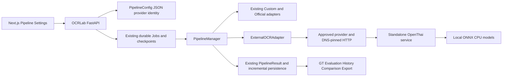

# External OCR architecture

The new mode/source is `external_api`. Existing `pipeline_configs.dynamic_mode` and `source` strings accept this value. The JSON `integrated_options` stores provider ID, provider name, response adapter and a SHA256 fingerprint of public routing/adapter settings. Existing columns and foreign keys support null DET/REC selections. Database schema changes are unnecessary.

`DynamicPipelineInput` validates an approved provider ID without DET/REC IDs. `DynamicPipelineService` resolves it server-side. Public config serialization exposes `external_provider` identity and keeps integrated model options separate. Existing snapshot/restore functions already persist these fields for durable Jobs.

Execution resolves the operator registry and compares its fingerprint with the saved Job configuration. Changes to destination, adapters, limits or public auth semantics require pipeline review/save before new execution. Removed or changed registrations fail safely. Credential rotation preserves the public fingerprint and uses the server credential at request time. Safe run provenance retains provider ID/name/adapter/fingerprint, genuine geometry availability and a validated upstream model revision when supplied. Credentials and upstream envelopes are excluded.

External adapters receive the same canonical PNG crop/ROI as other pipelines. The Backend performs one POST per logical Field execution without automatic retry. Existing checkpoint uniqueness prevents replay of committed outputs. A request interrupted before its output commits can be repeated after worker recovery. Existing GT prefill selects its established Custom DET/REC configuration and keeps its existing behavior.

OpenThai normalization preserves `data.text` and line order. Native polygons are converted with the existing geometry mapper and ROI offset once. Generic text JSON uses a maximum-four-component dotted dictionary path. Aggregate confidence stays null unless explicitly supplied by a configured generic provider. Shared normalization/scoring functions process the final text.

`global_layout_service.reading_lines` recognizes the external crop stage and preserves full provider text ordering, including multi-column order. Text-only outputs have an empty geometry list and a visible geometry-unavailable message in Pipeline preview. Global Field ROI outlines still show the user-selected crop.

The standalone package owns its dependencies, Dockerfile, read-only model snapshot, config, endpoints and tests. OCRLab Railway installs the HTTP adapter dependencies only. Model inference runs in the separately deployed service.
