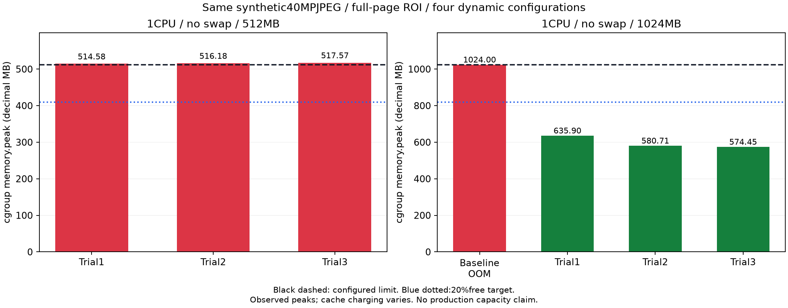
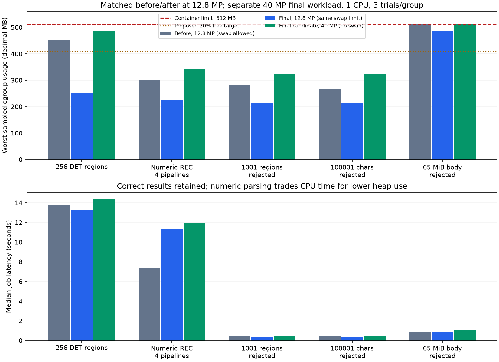
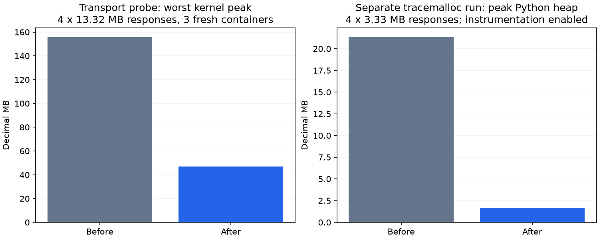

# OCRLab memory reliability — local pre-release evidence

## Final G6 fix — 10 November 2026

**PASS for the explicitly bounded prototype envelope**, not unlimited public capacity. [Final evidence](g6-release-evidence.json) contains source/image fingerprints, full-suite artifacts and per-phase cgroup/RSS/stat/events/recovery measurements. Backend650 and Playwright208 pass with no failures/skips for the final combined source.

The mixed workflow first evaluates legacy PDF GT, then processes a high-entropy2MP image across multiple Fields/configurations and GT prefill. Heap profiling identified approximately60MB of persistent `pythainlp.util.trie` nodes/dicts. `word_lexicon.py` passes a read-only sorted dictionary to the **same pinned newmm algorithm**, retaining identical stripped corpus words, prefix order and token decisions. Tests compare every corpus word at zero/non-zero offsets, random concatenations, Thai combining marks/English/numbers and WER counts with PyThaiNLP's original Trie. No whitespace-tokenizer substitution or formula change was made.

`native_memory.py` uses the GNU `malloc_trim(0)` hint only after owned PDF/adapter temporaries have closed. It returns free allocator pages, never live pixels/bytes, and is a safe no-op on unsupported platforms. There is no forced GC, TLS change, resolution reduction, new package or environment variable. Exact crop/polygon/PNG contracts remain tested.

The stress envelope also exposed retained output growth across12Fields×6Pipelines. The final declared admission is therefore24 selected Field/Pipeline outputs,128DETregions and32768OCRcharacters perField. Twelve Fields and six Pipeline options remain individually available; oversized combinations/outputs fail explicitly instead of truncating OCR. Accepted geometry coverage now tests128lines;129/256regions reject beforeREC. Historical over-limit records remain readable.

| Final measured case,512MB/1CPU/no swap | Total cgroup peak |
|---|---:|
| Mixed PDF/image/prefill,trial1 |393,707,520bytes|
| Same,trial2 |384,008,192bytes|
| Same,trial3 |383,287,296bytes|
|128DET,24outputs,12Fields×2Pipelines,rejections/errors and worker recovery|404,197,376bytes|

Worst headroom is21.0552%; all runs include charged file cache topped up to220MB, with no cache subtraction/drop. SIGKILL recovery produced24unique outputs preserving12committed checkpoints,attempt2,controlledexit137/OOMfalse. Before/after candidates and failed larger-envelope trials remain in the historical sections/evidence. This is not a claim that historical production502 was OOM.

## Previous candidate snapshots — superseded by final evidence above

## Latest candidate — 10 November 2026

Current scope is an **internship prototype / development and demonstration environment**, with no additional hosting expenditure. The old 40 MP envelope below is historical; the explicitly reduced candidate is [2 MP / PDF 140 DPI](supported-workload.md). Full validation of this combined candidate is **630 backend tests including local PostgreSQL and 208 Playwright tests**, with no failures or skips. TypeScript, ESLint, Ruff, production build and local clean migration/schema checks passed. These are actual `validation-bounded` artifacts, not the older 616/206 reports.

Current metrics and artifact hashes: [bounded workload evidence](bounded-workload-evidence.json). [Release decision](production-release-and-live-e2e.md) / [gates](production-release-gates.json).

The remaining counterexample is a supported 2 MP high-entropy image after PDF processing, four Fields, six selected configurations and automatic GT prefill: two fresh-container peaks **452,136,960 / 452,472,832 bytes**. This fits below the hard 512,000,000-byte cap in those trials but misses the conservative 409,600,000-byte acceptance target. No OOM or max-pressure event was observed. Do not call it an OOM, or a successful 20% margin.

At the highest sampled point, approximately **217 MB anon +220 MB file +10 MB kernel** were charged. RSS high-water was about 269 MB. Much of file memory was inactive and reclaimable, but excluding it from total is not equivalent to passing the target. Fresh containers and warm host filesystem caches also give lower totals; retain both. No kernel cache was manually dropped.

Allocation paths reviewed: incremental `ijson` parsing and bounded response spooling (already present); early raw tensor exclusion; response slicing/metadata ownership; canonical PNG reuse; Pillow/OpenCV crop/native-buffer scopes; PDFium page/bitmap/raster closure; multipart write chunks; sequential adapters/Fields; shared image admission and durable queue bounds. No routing, OCR text, geometry or metric change was used as a memory shortcut.

Diagnostic-only full cyclic GC after 34 PipelineManager calls released **0 RSS bytes** at the measured boundaries; live SSL contexts went from at most four to zero but total peak remained **452,608,000 bytes**. This does not support adding forced GC or altering TLS behavior. GNU `malloc_trim` diagnostics sometimes returned native pages, but file-cache charging differed between trials; no repeatable causal total-peak improvement was established. Neither diagnostic monkeypatch is in application code.

Small/typical images and repeated PDF/global-ROI/prefill tests pass locally. They do not invalidate the larger supported counterexample. No blanket 512 MB safety claim or historical HTTP502 root-cause claim is made. There is no paid resource upgrade, merge or deployment.

## Historical evidence — 9 November, superseded workload and test counts

> ผลล่าสุด 9 พฤศจิกายน: [zero-cost release report](production-release-and-live-e2e.md), [17-trial evidence](high-entropy-memory-evidence.json), [hosting audit](zero-cost-hosting-assessment.md). Image/stream fixes เป็น uncommitted source บน HEADb0a3a16; fullbackend616/fullPlaywright206ผ่านใหม่ แต่ **512MB/40MPยังไม่ผ่านmargin และไม่อนุญาตpaidresources** จึงยัง RELEASE BLOCKED ไม่มีการเปลี่ยนProduction

## Current high-entropy remediation

Stage profileยืนยัน decodedPILbuffersหลายชุดค้างขณะawaitRECจนชน1GBก่อนแก้ แก้ให้borrow decodedsourceอย่างมีowner,explicitcloseownedpixelsก่อนawait,errorและcancel,stream-comparecanonicalPNGเพื่อreuseเฉพาะbytesที่ตรง,และส่งmultipartผ่านownedfilecursor64KiB โดยไม่เปลี่ยนwirecontract/coordinates/PNG/GT/JobIDs/defaultlimits

Perspectiveใช้originและmatrixเดิม;prefixcopyที่เล็กมากลดNumPyfull-pagecopies แต่กรณีใหญ่ยังใช้เดิม Tight-bboxtranslationถูกปฏิเสธเพราะ1/1000ทดลองpixelsต่าง ไม่ใช้การresizeหรือqualitylossเพื่อให้memoryดูดี

| Final combined candidate | Repeated functional result | Worst cgrouppeak | Memory result |
|---|---|---:|---|
| 512MB/40MPJPEG/fullROI/4configs/no-swap | 3/3,OOM0,hashตรง | 517,574,656bytes | FAIL:pressure/ไม่มีmargin |
| Local1024MB comparisonของcaseเดียวกัน | 3/3,OOM0,hashตรง | 635,899,904bytes | PASS boundedfixture,37.90%free;ไม่ได้อนุมัติdeploy |
| 512MB/compressible40MP | scenariosผ่าน3/3 | 512,000,000bytes | FAIL20%target |
| 512MB/12.8MPmultiplefields | scenariosผ่าน3/3 | 475,385,856bytes | FAIL20%target |
| 512MB/0.8MP,4fields/4configs | 3/3,16uniqueoutputs | 346,275,840bytes | PASSเฉพาะmeasuredcase,32.37%free |

SIGKILLและSIGTERMrecoveryผ่านบนfinalsource:48uniqueoutputs,32เดิมcheckpointsครบ,attempt2ทั้งคู่ SIGKILL137เป็นcontrolledkill/OOM=false;SIGTERMexit0 ไม่สับสนกับbaselineOOM=true ภาพเดิม119,861,390-bytecanonicalPNGตรงinputhash;response65MiB/1001geometry/100001charsและsynthetic503ถูกจัดfailureตามจริง

Separateheap-run1GB:tracedPythonpeak198,242,715bytes;RSShigh-water629,104,640bytes;kernelpeak766,087,168bytes แยกจากnormalcapacity/latencycomparison ตัวเลขtransport-only21.32→1.66MBในhistoricalsectionไม่ใช่heapของ40MPimagecaseนี้ Filecache/nativepixels/kernelและrestartsมีrawsamplesพร้อมartifacthashes

Cold/filecachechargingต่างระหว่างtrial ห้ามยกobservedmaxที่ลดลงไปอ้างเป็นcausaleffectเฉพาะหนึ่งpatch และไม่ใช้localOOMสรุปhistoricalproduction502 CPythonBytesIO(immutablebytes)probeไม่พบwhole-bodyPythonallocationเพิ่ม จึงไม่ยืนยันข้อสันนิษฐานเดิมว่าobserverBytesIOcopyPNGทั้งหมด

Source/testfingerprint `a31402926ea4059f4297db06e5fd3b743e286aea26bf34c400c682fc3782d45c`;Dockerbackend79/79ตรง ไม่มีnewmigration/env/dependency/schema/prodresourcechanges Newtests33cases,backend616/616และPlaywright206/206เป็นfreshresults. Reproducefixture: `backend/.venv/Scripts/python.exe postman/staging/high_entropy_fixture.py --output .runtime/high-entropy.jpg` (refuseoverwrite)

ยังไม่ลด40MP/upload/concurrencylimits ผล0.8MPไม่ใช่สิทธิ์ลดproductcapabilityหรือpass40MP. No paidplan/upgrade/migration/merge/deploy;budget0THB. Fullreportอธิบายhostingeligibilityและข้อจำกัดของoverlappingrequests/metadata/JSONBase64/largePDFที่ยังไม่เป็นuniversalcapacityproof

## Historical snapshot — 607af99 → f8c7949 (ไม่ใช่ final source ล่าสุด)

ตรวจ 8–9 พฤศจิกายน 2569 จาก baseline `607af992867dd33425597d22efb5d7f489fbadc7` บน branch `perf/ocr-memory-reliability`; code candidate `f8c7949ba5e11e162e59b340b37d0dc607a38b54`. ผลสำหรับ **512 MB: NO-GO** ไม่มีการปรับ Production resources

## สิ่งที่แก้

- `model_gateway.py`: ตรวจ Content-Length ที่เชื่อถือขนาด decoded ได้ก่อนอ่าน; อ่านเป็นช่วง 64 KiB และตรวจ decoded byte limit ก่อนเขียน; RAM spool 1 MiB ต่อ response แล้วใช้ OS-private temporary file ซึ่งปิดทุก exit path ก่อนคืนผล ไม่เขียนใน uploads และไม่ log ชื่อ/เนื้อหา
- `gateway_response.py`: ใช้ ijson 3.6.0 ตรวจ JSON ทั้งหมด แต่ไม่สร้าง Python object tree ของ top-level transport archives และ embedded image tensors ที่ถูก redact อยู่แล้ว เก็บ data/meta/error และ sanitize strings ระหว่าง parse ไม่มี tree copy รอบที่สอง
- `image_service.py`: transpose EXIF ใน image ที่ decode อยู่แล้ว; ไม่ทำสำเนา RGB ที่ไม่จำเป็น; เปิด RGB โดย load pixels ก่อนปิด input buffer; crop RGB เฉพาะ ROI แทนแปลง source ทั้งหน้าเป็น NumPy ล้าง crop metadata ให้ตรงกับ Image.fromarray เดิม
- ไม่เปลี่ยน model routes/params, OCR predictions, metrics/GT, field/job/checkpoint IDs, default concurrency, image limits หรือ batch limits ไม่มี migration และไม่มี environment variable ใหม่
- JSON parser ต้องเป็น JSON ที่สมบูรณ์; NaN/Infinity literals ซึ่งไม่ใช่ JSON มาตรฐานถูกปฏิเสธเป็น INVALID_RESPONSE ส่วน finite numbers, arbitrary-size integers และ exponent overflow ที่ sanitize เป็น null มี regression tests

## วิธีวัด

Docker local เท่านั้น: backend memory.max **512,000,000 bytes**, **1 CPU**, fields group 8, pipeline tasks 4, Gateway batch default **4** (protocol/adapter line grouping cap 30), response limit 64 MiB ค่าเดิมทั้งหมด ใช้ mock ที่แยก container และ synthetic image ไม่มี CDGS/Production credentials

ภาพ 4000×3200 (12.8 MP) และ 8000×5000 (40 MP) เป็น PNG สังเคราะห์ที่บีบอัดได้ดี วัดแต่ละกลุ่ม 3 รอบ พร้อม accepted/rejected workloads แยกกัน: 256 DET polygons; REC numeric transport ประมาณ 3.33 MB ต่อ image/13.33 MB ต่อ batch; 1001 polygons; 100001 REC characters; streaming body 65 MiB จับ CPU user/system, RSS, cgroup current/peak/stat/events/swap และ decoded bytes ที่อ่าน รายละเอียด/หลักฐาน hashes อยู่ [JSON](memory-reliability-evidence.json)

Original swap-default trials และ no-swap trials แยกกลุ่ม ไม่รวมเป็น baseline เดียวกัน `memory.peak`/events สะสมภายใน container lifetime ส่วน phase peaks เป็น sampled current; sampler ไม่รับรองว่าจะจับ transient ทุกจุด จึงใช้ kernel peak ตรวจขอบบนด้วย RSS อาจรวม shared pages ที่ไม่ถูก charge ให้ cgroup นี้ ห้ามเอา RSS ลบ cgroup แล้วตีความเป็น heap

## ผลสำคัญ

| Experiment | ก่อน | หลัง | ข้อสรุป |
|---|---:|---:|---|
| Transport-only kernel peak, worst of 3, 4×13.32 MB, no swap | 155.66 MB | 47.10 MB | ลดประมาณ 69.7%; เป็น transport probe ไม่ใช่ full backend |
| Separate tracemalloc peak, 4×3.33 MB | 21.32 MB | 1.66 MB | ลดประมาณ 92.2%; latency ของ instrumented run ไม่ใช้เทียบ normal run |
| Image-only 40 MP at 512 MB, no swap | OOMKilled=true 3/3 | ผ่าน 3/3; peak 368.98 MB | Full-image copies เป็น defect ที่ reproduce ได้ใน local |
| Baseline 40 MP reference, RAM local 1024 MB | peak 684.36 MB | PNG และ 8 crop hashes ตรง candidate | ใช้ยืนยัน bytes เท่านั้น ไม่อ้าง baseline ผ่านที่ 512 MB |
| Final full backend 12.8 MP, tasks4/no swap, worst kernel peak | — | 488.37 MB | เหลือประมาณ 4.6%; ไม่ถึง proposed 20% |
| Final full backend 40 MP, tasks4/no swap | — | 512.00 MB | แตะ limit แม้ observed OOM/kill=0 |
| Final 40 MP tasks2/no swap — local alternative | — | 476.15 MB | เหลือประมาณ 7.0%; ยังไม่ถึง proposed target |
| Final 40 MP RAM1024 MB/tasks4/no swap — local alternative | — | 599.20 MB | เหลือประมาณ 41.5% สำหรับ workload นี้เท่านั้น |

## Allocation และ latency

Baseline json.loads materialize transport floats ทั้งก้อนก่อนทิ้ง: isolated heap instrumentation ยืนยัน retained allocation ที่ json.loads ส่วน raw-only extraction เก็บ scalar/geometry ก่อน pop archive เดิม และ recursive sanitizer เดิมสร้าง object tree ใหม่

Incremental event filtering ลด heap แต่ใช้ CPU เพิ่มกับ numeric tokens: transport probe median latency ~0.724→1.752 s; matched full numeric workload 12.8 MP ที่ swap limit เดียวกัน ~7.34→11.29 s. แยก no-swap final ~11.88 s; ต่างรอบ/สภาพ warm state มีผล ไม่ตีความเป็น model speed. Matched full-workflow worst kernel peak ~512.21→489.66 MB ยังคงไม่ถึง proposed margin เพราะ rejection/file-cache pressure. Full backend CPU time ต่อ phase และ timings ทุก trial เก็บใน evidence

Prototype ที่ parse ตรงจาก HTTP stream ไม่ผ่าน: string 65 MiB ที่ยังไม่จบทำให้ parser เก็บ token ใหญ่พร้อมกันหลาย request เกือบเต็ม limit และ rejection median ~37.21 s จึงเลิกใช้แบบนั้น Temporary spool ปฏิเสธก่อน parse ลด rejection มาแถว 1–2 s แต่เปลี่ยนความกดดันบางส่วนจาก anon heap เป็น file cache ตัวอย่างก่อน image fix ที่ peak: anon ~267.10 MB, file ~219.37 MB, kernel ~12.79 MB

BatchGateway ยัง deepcopy เฉพาะ owned result slices เพื่อแยก mutation ระหว่าง callers; allocation probe พบ copies ของ slices เล็กกว่าต้นทุน parse มาก จึงไม่ถอด isolation เพื่อประหยัด RAMอย่างคาดเดา Result order/aliases และ 30+4 splitting ยังมี tests

Image decoding/crops ใช้ native Pillow/OpenCV buffers ซึ่ง tracemalloc ไม่ได้สะท้อนทั้งหมด จึงดู RSS/cgroup โดยตรง Full-page np.asarray และ EXIF/RGB copies เดิมทำให้ image-only 40 MP baseline ถูก local OOM kill จริง ไม่ใช่หลักฐานสาเหตุ historical HTTP502

## Integrity และข้อจำกัด

- Final worker interruption: 48 unique persisted outputs; checkpoint IDs ทั้ง 32 เดิมยังอยู่; attempts=2 มี final ID lists ใน ignored synthetic evidence และ hash ให้ตรวจ ไม่รัน inference แบบ exactly-once หาก crash ก่อน commit
- Prediction hashes ของ accepted/rejected results ตรง baseline; EXIF orientations 1–8, RGB/RGBA/L/P/CMYK conversion และ ROI metadata/PNG/hash มี exact reference tests
- Stream limit ไม่ใช่ heap limit: retained JSON data tree, scalar string tokens, HTTPX decompression allocations และ native image allocations ยังขยายได้ การอ่าน 64 KiB ไม่รับรองว่า decoder ภายในจะไม่ allocate มากกว่านี้
- Temporary disk budget อาจถึง 4×64 MiB ต่อ active worker/manager พร้อม file cache; ต้องมี writable temp directory/พื้นที่ว่าง/permissions และ admission ระดับ deployment ไม่ถือว่า spool เป็น durable storage
- 40 MP fixture บีบอัดได้ดี ไม่ครอบคลุมภาพ noise/high-entropy, PDF ทั้ง 500 หน้า, ทุก model shape, multiple instances หรือ adversarial compressed responses ไม่มีข้อสรุปว่าทุก input ที่ config อนุญาตผ่าน resource envelope นี้
- ไม่ลด MAX_IMAGE_PIXELS, task/field/batch/response limits เพื่อให้ผ่าน ตัวเลือก tasks2/RAM1024 เป็น local measurements เท่านั้น ต้องอนุมัติ operational settings แยกก่อนใช้จริง
- Proposed ≥20% free เป็นเกณฑ์ประเมินในงานนี้ ไม่ใช่ Production requirement ที่ได้รับอนุมัติแล้ว

## Recommendation

**NO-GO / BLOCKED สำหรับ 512 MB default envelope** แม้ tests ความถูกต้องผ่านและ allocation ลดลงมาก ทางเลือก 1024 MB มีหลักฐานดีกว่าสำหรับ bounded synthetic workload นี้ แต่ยังต้องทดสอบ representative non-sensitive images/PDF, compressed outputs, sustained sessions, temp storage และ public request admission ก่อนถือว่า Production-safe ไม่มีการอัปเกรด Production ในงานนี้

ดู [release readiness](production-release-readiness.md) สำหรับ policy, deployed read-only checks, incident และแผนอนุมัติ release ที่ยังไม่ execute
