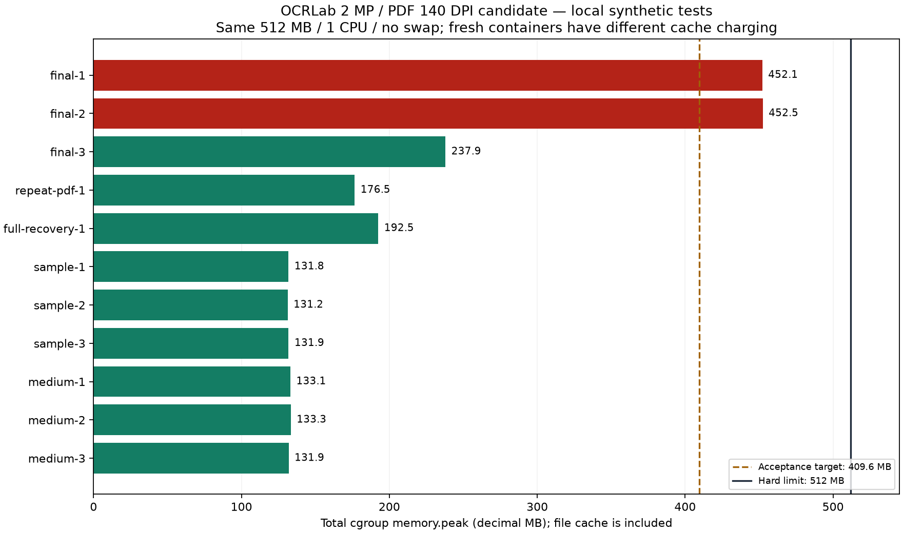
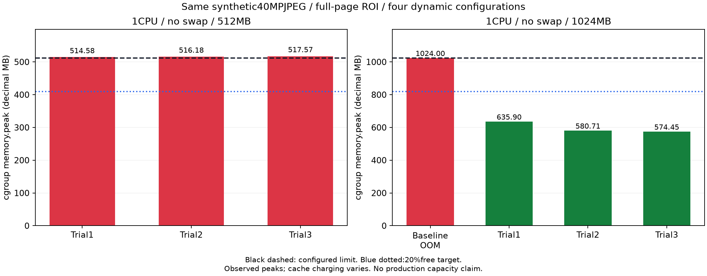

> Current 80-Field upgrade: [final verification](multifield-release-verification.md), [resource evidence](multifield-memory-evidence.json), [gate ledger](production-release-gates.json). The earlier release/history below remains historical; its counts and deployment IDs are not evidence for this new candidate.

# OCRLab — Internship prototype release verification

## Final release candidate — G6 fixed

ผู้ใช้อนุมัติ normalPRmerge→existingauto-deploy→realChromiumE2E เมื่อgatesผ่าน รอบสุดท้ายแก้สาเหตุword-dictionary/native-retentionโดยคง2MP/PDF140DPI และประกาศ24Field×Pipelineunits/128DETregions/32768OCRcharactersต่อFieldอย่างเปิดเผย ไม่truncateหรือเปลี่ยนGT/metrics/modelrouting

ผลใหม่: **Backend650/0fail/0skip** รวมPostgreSQL; **fullPlaywright208/0fail/0skip** หลังแก้rollingAPIcompatibility;TypeScript/ESLint/build/Ruff/localmigrationdriftPASS. [Finalevidence](g6-release-evidence.json) bindsource/imagehashesและartifacthashes;[supportedworkload](supported-workload.md)เป็นcontractปัจจุบัน

Mixed3รอบpeak393,707,520/384,008,192/383,287,296bytes;fullresource/recovery404,197,376bytesเหลือ21.0552%ใน512,000,000bytes/1CPU/no-swap นับfilecacheเต็มและเติมchargedcache220MB ไม่มีOOM/pressuremax Forcedrecovery24uniqueoutputs/12preservedcheckpoints/attempt2

ProductionNeonfreshreadonlyrevision0012,columncompatibilityและaggregate53.35MBผ่าน ไม่มีschemachange/migration. Railwayrepo/main/backendwatchและVercelproject/rootเดิมตรวจแล้ว;healthcheck`/api/health`180sเตรียมสำหรับnextdeployment,sleep=trueคงเดิม เตรียมexistingPDF_RENDER_DPI140แบบskipDeploysก่อนmerge ไม่เปลี่ยนsecrets/plan/resources

G10ผ่านเฉพาะscopedexistingpersonalprototype/no-new-paid-operationตาม[hostingassessment](zero-cost-hosting-assessment.md). Noauth/publicsharedriskและephemeralhistoricaluploadriskยังaccepted ไม่มีการอ่าน/export/deleteuploadsเดิม

Branchprotectionmetadataรายงานmainprotected=false/requiredcontexts=[]และrulesets=[];จะยังmergeผ่านPRและexpectedheadSHAตามปกติ ไม่pushตรงmainหรือforcepush GitHub/Vercelchecksตรวจอีกครั้งหลังfeaturepush

**นี่เป็นpre-mergegate record ไม่ใช่การอ้างว่าdeploy/liveE2Eผ่านล่วงหน้า** Commit/deploymentIDsและผลliveทดสอบจริงเก็บในignoredreleasejournalและรายงานส่งมอบหลังauto-deploy ไม่มีการหยุดที่readinessหากขั้นตอนที่เหลือผ่าน

## Previous blocked handoff — retained for audit, superseded by final candidate above

## ผลล่าสุด — 10 พฤศจิกายน 2569

**RELEASE BLOCKED / NO-GO สำหรับการปล่อยรอบนี้** งานแอปที่ทำไว้คงอยู่ครบ ยังไม่มี commit/push/merge/deploy ใหม่ ไม่เพิ่มค่าใช้จ่าย ไม่แก้ Production configuration/database/uploads และ REQ-12 OUT OF SCOPE เหตุที่ยังไม่ปล่อยคือ memory acceptance และ account quotas บางส่วน ไม่ใช่เพราะต้องทำ enterprise hosting หรือเพิ่ม Login

[Gate ledger](production-release-gates.json) · [Supported workload](supported-workload.md) · [Current memory evidence](bounded-workload-evidence.json) · [Hosting assessment](zero-cost-hosting-assessment.md)

### Workspace และ source ที่ตรวจ

- Branch `perf/ocr-memory-reliability`, HEAD `b0a3a167e4c8f9f92c0e9e93d2deb6a70b1ac688` พร้อม uncommitted application/tests/docs ที่รักษาไว้ ไม่ reset หรือแทนด้วย branch เก่า
- Fetch ล่าสุด: `origin/main=695bf4b0f3355653ea4c82102e6586debaac9c2b`; GitHub PR#13 **Draft/open/unmerged**, HEAD `607af992867dd33425597d22efb5d7f489fbadc7` ไม่เปลี่ยน
- Candidate ใหม่ยังไม่มี commit SHA. Source/test manifest267ไฟล์ SHA256 `241375d2bceeda4b5427fe3925291f6cdbb611a0ccaae2944ac36e5118f436e2`; backend source ใน Docker ตรง80/80ไฟล์
- Index ว่าง `.env`/`.runtime` ignored และไม่ tracked; raw Docker inspect, local DBs, private logs/probes ไม่เป็นไฟล์ส่งเข้า Git

### ขอบเขตที่แก้และตรวจแล้ว

คง image lifetime/PNG reuse/perspective-exactness/multipart-streaming fixes เดิม เพิ่ม policy ที่ผู้ใช้อนุมัติให้ลดอย่างเปิดเผย: **2 MP/ด้านละ8000px,10MiB,PDF20หน้า/ค่าเริ่มต้น140DPI,12Fields/6selectedPipelines,1executor,queued+running5,physicalbatch1,response8MiB** ไม่มี silent downsampling

ตรวจ image header ก่อน decode/read ทั้งไฟล์; PDF ตรวจ raster dimensions ก่อน bitmap. HTTP413/422 สำหรับ inputเกินขนาด และ429สำหรับ admission/queueเต็ม แสดง Thai/English limits ผ่าน `/api/upload-config` และหน้า Upload/เลือกPipeline. หนึ่ง image slot +หนึ่ง waiterรอไม่เกิน2วินาที ป้องกัน normal PDF navigation แข่งกันแล้วถูกปฏิเสธทันที Polling/GT/saved resultsไม่ถือ image slot

Historical metadata/GT/results/coordinates/checkpoints คงอยู่ การประมวลผล sourceเดิมที่เกินpolicyถูกปฏิเสธชัดเจน ไม่ลบหรือสร้าง sourceปลอม StoredPDFDPIยังเดิม ไม่เขียนทับพิกัดเก่า ก่อน releaseอนาคตต้องตรวจ existing `PDF_RENDER_DPI` เพราะค่า200ทำให้A4เกิน2MP;เตรียม140สำหรับPDFใหม่ ไม่ได้เปลี่ยนsecret/environmentในรอบนี้

ไม่เปลี่ยน model routing, CER/WER/ExactMatch, Dataset image+confirmedGT label semantics, PipelineRun IDs หรือ idempotency ไม่มี migration/envvar/dependencyใหม่

### ผล validation ของ candidate ปัจจุบัน

Full runs ของ candidate นี้เสร็จในช่วงก่อน recovery ล่าสุด; รอบต่อเนื่องนี้ตรวจ XML/log/exitJSON และ hashซ้ำ **ไม่ได้อ้างว่าเพิ่งรัน616/206เก่าใหม่** ไม่มี application sourceเปลี่ยนหลัง630/208 มีเฉพาะ docs/ignored resource probesเพิ่ม

| Check | Actual result / command |
|---|---|
| Backend รวม localPostgreSQL | **630passed/0failed/0error/0skip**, childexit0,110.26s. `backend/.venv/Scripts/python.exe -m pytest -q --tb=short --junitxml=...` ใช้เฉพาะ guarded localhost `TEST_DATABASE_URL` และ unique basetemp |
| Full Playwright | **208passed/0failed/0skip**, exitJSON0,4.9m. `npx.cmd playwright test` ผ่าน isolated local backend/web wrapper; synthetic upstream |
| TypeScript / ESLint | `npm.cmd run typecheck` / `npm.cmd run lint`: exit0 |
| Production build | `npm.cmd run build`: PASS; standalone output retained |
| Ruff | app/tests และ memory probes PASS; final diff/secret/link/hash checksบันทึกในgateledger |
| Database | fresh local clean→0011→0012_ocr_jobs,15tablesรวมversion, Alembic check no drift. Production auditเดิม9พ.ย.เป็นmetadata-only14ORMcolumnsets ไม่ใช่fulltype/index/constraintdrift;ไม่มีmigrationจำเป็นหรือรันProduction |

หลักฐาน `.runtime/memory-reliability/validation-bounded/` เก็บ pytest XML/log, Playwright full log/exitJSON, build/static/schema logs; hashesใน current evidence. Dataset correctionไม่ได้ทำให้invalidexportผ่าน: ยังคาด422หลัง bounded429retry. Fixture changesไม่ลบ/skiptests: แยกexplicit200DPIgeometryprofile, multi-image batchingoverride, ขนาดPDFอยู่ใต้2MP, cleanupเฉพาะtest-createdpipelines, historical38Fieldsrenderingพร้อมassertnew38write422/actual12fieldjob. Default140DPI/A4และlimitvisibilityมีtestsแยก

### Memory และ resource evidence

ทุกtrialใช้localDocker512,000,000bytes/1CPU/no-swap/1backend พร้อมDB/mockGatewayแยก ไม่เชื่อมProduction/CDGSจริง

| Case | Functional / memory result |
|---|---|
| 2MP high-entropy หลังPDF +4Fields×6configs +GTprefill สามfreshcontainers | Functional3/3; peaks **452,136,960 /452,472,832 /237,920,256bytes**. สองรอบแรกเกิน409,600,000target จึงไม่ผ่านรวม;OOM/maxevents0 |
| Small sample / typical1.6MP | อย่างละ3/3; worst131,858,432 /133,320,704bytes |
| PDFpage2 A4/globalROI→6configs→GTprefill ซ้ำ3ครั้งในprocessเดิม แล้วต่อภาพ2MP | ทุกprefillready,6uniqueoutputsต่อPDF; combinedpeak176,537,600bytes |
| 256DET /24fieldoutputs /1001DET /100001RECchars /oversizedresponse /503 /workerinterruption | ทุกexpectedstatusผ่าน; peak192,512,000bytes; noOOM/maxevents |
| ForcedSIGKILL recovery | **72uniqueoutputs,36committedcheckpointIDsเดิมครบ,attempt2**; controlledexit137/OOMfalse แยกจากOOMkill |
| Rejected40MP image /oversizedPDFraster | 413ก่อนinference; unitnegativepathsห้ามdecode/rasterของrejectedinput |

Cold/warm filesystemcache chargingต่างกัน: รอบสูงมีanon≈217MB/file≈220MB/kernel≈10MB, RSSHWM≈269MB. ไม่ตัดfilecacheออกแล้วเรียกว่า20%marginผ่าน ยังไม่เสนอลดmarginเพียงเพื่อปล่อยงาน Native/Pythonallocationsไม่ใช่ขนาดเดียวกับcgrouppeak

ProfilingGC34unitboundariesลดRSS0bytesแม้SSLcontextsถูกเก็บครบ จึงไม่เพิ่มforcedGCหรือแก้TLS. `malloc_trim`diagnosticsมีcacheconfoundจึงไม่เพิ่มลงapp. เก็บfailed8/6/4MPและ40MPhistoricalevidenceไว้ครบ ไม่ทดลองunsupported40MPinferenceซ้ำ ผลlocalOOMเก่าไม่พิสูจน์historicalProduction502

ข้อจำกัด: รอบresourceใหม่ไม่ได้ทำmemoryprofileของtimeout/429/cancel/SIGTERMและsimultaneousqueue-admissionแยกทุกกรณี;มีfunctionalpytest/Playwrightnegativecoverage แต่ไม่ใช้แทนmemorymeasurements ไม่อ้างProductioncapacityจากmockหรือonefixture

### Zero-cost / product policy

ผู้ใช้ยืนยัน **ไม่มีค่าจ้างสำหรับพัฒนา/ดูแล เป็นเดโมส่วนบุคคลเพื่อการศึกษา** ใช้เป็นcurrentfactประเมินVercelHobbypersonal/non-commercial ไม่ใช้futurecompanyadoptionเป็นblocker. ActualVercelteamยังHobby/active/nontrial ไม่มีprojectใหม่

RailwayยังFREE512MB/1CPU/1replica. Read-onlybillingmetadataยืนยันเครดิตเหลือ **$0.7492306288**, currentusage$0.2507693712, projectedperiodusage$0.3369235438,freeplanยังไม่exhausted. ไม่แปลusageเป็นinvoiceที่จ่ายแล้ว ไม่รับประกันquotaหลังpublictrafficเพิ่ม. NeonaccountquotaและCDGSentitlement/requestbudgetยังยืนยันไม่ได้ จึงยังไม่ให้G10รวมPASS ดูassumptionsในhostingreport

Publicsharedworkspaceยังไม่มีauthตามข้อกำหนด: ใครเข้าถึงURLอ่าน/แก้/ลบ/configureข้อมูลส่วนกลางได้ เป็นacceptedrisk ไม่ใช่accesscontrol. Ephemeraluploadlossเดิมaccepted;metadata/GT/resultsในNeonไม่สามารถสร้างsourcebytesที่หายกลับมา ไม่มีการแตะuploadsหรือdataจริง

### G1–G11 และ release state

| Gate | Status |
|---|---|
| G1Code /G2Backend /G3Frontend /G4BaselineSafety /G5Schema | PASS พร้อมข้อจำกัดในledger |
| G6Memory | **FAIL** conservative margin |
| G7Contracts /G8Recovery | PASS local;externalavailabilityยังไม่verified |
| G9Operations | BLOCKEDตามmemory/hosting;ไม่อ้างsafeoldrollback |
| G10Costs/Terms | BLOCKEDเฉพาะquotas/entitlementที่ยังไม่ยืนยัน;Vercelstatedpersonaluseassessmentผ่าน |
| G11GitIntegration | BLOCKEDตามconditionalrelease;ไม่commit/push/mergeเมื่อgatesยังไม่ครบ |

Newcommit/mergeSHA: **ไม่มี**. PR#13ยังDraft. NewRailway/VerceldeploymentIDs: **ไม่มี**. PreviousIDs`468e0200-d1be-41b9-a201-2288b8be0fc0` /`dpl_G1EMQukFRhHdtVp2chQcCmj98nbT`เป็นhistoricalrecords ไม่ใช่candidateที่deployแล้ว. Backendhealthใหม่/realdeployedbrowserE2E/syntheticliveOCR/postrelease-monitoring: **NOTRUN**

Rollbackต้องยืนยันschemaและresourcesก่อน: codeเดิมไม่มีschemaใหม่ให้downgrade แต่การกลับไปallocation/limitsเก่าไม่ใช่memory-safeautomaticrollback และไม่คืนephemeraluploads ทางต่อคือวัด/แก้remainingnative/cachepressureของsupportedmixedworkflowหรือให้เหตุผลmarginทางวิศวกรรมที่ทวนได้ แล้วตรวจNeon/CDGSquotasและremote/CIใหม่ ไม่ซื้อแพ็กเกจหรือย้ายhostโดยพลการ

## Historical report — 9 November (superseded limits/counts; retained evidence)

9 พฤศจิกายน 2569 · **RELEASE BLOCKED / NO-GO บน infrastructure ที่อนุญาต** · REQ-12 OUT OF SCOPE

แก้การถือ image buffers และตรวจ final candidate ในเครื่องเสร็จแล้ว แต่ **G6 ที่512MBยังไม่ผ่าน และG10ยังรับรอง0บาทสำหรับdeploymentที่เข้ากันได้/เข้าเงื่อนไขผู้ให้บริการไม่ได้** จึงหยุดก่อน commit/push/merge/deploy ตามคำสั่งล่าสุด ไม่มีการซื้อแพ็กเกจหรือเปลี่ยน Production

[Gate matrix JSON](production-release-gates.json) · [Memory evidence](high-entropy-memory-evidence.json) · [Zero-cost hosting assessment](zero-cost-hosting-assessment.md)

## 1. Git และ final candidate

- Branch `perf/ocr-memory-reliability`; HEAD `b0a3a167e4c8f9f92c0e9e93d2deb6a70b1ac688` พร้อม changes ที่ยังไม่ commit
- Final candidate จึง **ยังไม่มี commit SHA ใหม่** ไม่ใช้ `f8c7949` เรียกแทน source ล่าสุด
- Source/test fingerprint SHA-256: `a31402926ea4059f4297db06e5fd3b743e286aea26bf34c400c682fc3782d45c` ครอบคลุม264ไฟล์; Docker image ตรง backend source79/79ไฟล์
- Fetch ตรวจ `origin/main=695bf4b0f3355653ea4c82102e6586debaac9c2b`, PR#13ยัง Draft/open/unmerged, HEAD `607af992867dd33425597d22efb5d7f489fbadc7`
- Local commits `f8c7949` และ `b0a3a16` ยังไม่ push; index ว่าง ไม่มี reset/discard/force push หรือแก้ branch protection

## 2. Root cause และ verified fixes

Stage profiler กับ JPEG/hash เดิมพบ sourceและหลายadapterถือ decoded RGB40MPพร้อมกันระหว่างรอREC: แต่ละภาพประมาณ160MB;ก่อนOOMมี tracked PIL buffersประมาณ480MB แล้วการเปิด crop/แปลงNumPyเพิ่มชน1GB การแก้ไม่ได้ลดqualityหรือresize

1. [image_service.py](../backend/app/services/image_service.py): ยืม decoded source ภายใต้ขอบเขตownerที่ชัดเจน; full-page metadata-free RGBไม่สร้างpixelcopyซ้ำ; PNGencoderเปรียบเทียบchunksกับsourcebytesก่อนreuse จึงไม่ต้องallocate PNG119,861,390bytesซ้ำเมื่อพิสูจน์ว่าเหมือนกันจริง มีmetadata/non-RGB fallback
2. [benchmark.py](../backend/app/pipelines/benchmark.py): ปิด owned crop/nativepixels ก่อนawaitREC ไม่ถือ decodedcropแยกหลายชุดระหว่างรอnetwork; borrowedsourceยังเป็นของcaller ไม่ปิดผิดตัว การออกจากPillowcontextอย่างเดียวไม่รับประกันreleasepixelcore จึงใช้ explicit `closing`
3. Perspective cropsใช้matrixเดิมและorigin(0,0)เดิม ตัดเฉพาะprefixที่เล็กมากพร้อมcubic-interpolationmargin กรณีใหญ่ใช้เดิม ไม่ใช้tight-bboxtranslationที่ทดลอง1000กรณีแล้วpixelsต่าง1กรณี
4. [global_layout_service.py](../backend/app/services/global_layout_service.py) และ [test_case_service.py](../backend/app/services/test_case_service.py): ส่ง immutable canonicalbytes/sourceภายใต้lifetimeของjob; ปิดdecodedsourceในfinally/contextที่ปิดnativecoreจริง
5. [model_gateway.py](../backend/app/integrations/model_gateway.py): HTTPXส่งrawbytesเป็นwriteก้อนใหญ่จริง เปลี่ยนเป็นownedreadcursorต่อattemptเพื่อส่งmultipartทีละ64KiB และปิดเมื่อsuccess/error/cancel โดยไม่ปิดfilehandleของcaller Wirebytes,Content-Length,filename,fields,query,authenticationและorderingมีexactregressions; JSONBase64ไม่ได้เปลี่ยน

หลักฐานคำสั่งทดลอง HTTPX: raw32,000,000bytes→maxchunk32,000,000; file-stream→65,536. นี่พิสูจน์chunkproperty ไม่ใช่การอ้างว่าpeakลดทั้งหมดเพราะสาเหตุเดียว Cold/file-cache charging ต่างระหว่างรอบ จึงแยกobservedpeakจากcausal allocation

ไม่มีการเปลี่ยน model routing/DET/REC versions/weights, OCR predictions/geometry, GT/CER/WER, Dataset label semantics, JobIDs/idempotency/checkpoints, acceptedformats หรือdefaultlimits/concurrency ไม่มีmigration/envvar/dependencyใหม่ในรอบนี้

## 3. Final resource envelope

Fixtureเดิม: RGB JPEG8000×5000=40MP,11,195,470bytes,quality30,seed20261109; SHA256 `264c0b9576405f17896b0db096649f7743ceebc68a872360ea599596a32f936d` ภาพสังเคราะห์ทั้งหมด ไม่มีProduction/CDGSinference

Pipelineconfigsเดิม4ชุด, full-pageManualROI1field,1CPU,swap0. Uploaded canonical-source hashตรงruninputhashทั้ง4 และpredictionsignatureตรงกันทุกtrial CanonicalPNG,coordinatesและrecognitioncropsมีexactreference tests

| Final workload | RAM / repetitions | ผลfunctional | Worst kernelpeak | Memory verdict |
|---|---|---|---:|---|
| High-entropy40MP/fullROI/4configs | 512,000,000bytes ×3 | 3/3ผ่าน,4uniqueoutputs/ครั้ง,OOM=0 | **517,574,656bytes** | **FAIL** ชน/เกินlimitชั่วขณะ ไม่มีmargin |
| เดียวกัน — localcomparisonเท่านั้น | 1,024,000,000bytes ×3 | 3/3ผ่าน,hashตรง,OOM=0 | **635,899,904bytes** | PASS สำหรับboundedfixture เหลือ37.90%;ไม่อนุญาตpaiddeployment |
| Compressible40MP,256DETregions,concurrentREC/rejections/errors | 512MB ×3 | ทุกscenarioผ่าน,OOM=0 | 512,000,000bytes | FAIL proposed20%margin |
| 12.8MP/multipleFields/4configs รวมinterruption | 512MB ×3 | ทุกscenarioผ่าน,OOM=0 | 475,385,856bytes | FAIL proposed20%margin |
| 0.8MP1000×800,4Fields/4configs,numericREC | 512MB ×3 | 3/3ผ่าน,16uniqueoutputs/ครั้ง | **346,275,840bytes** | PASS เฉพาะcaseนี้ เหลือ32.37%;ไม่ใช่การอนุมัติลด40MPlimit |
| SIGTERM recovery12.8MP | 512MB ×1 | 48uniqueoutputs/32checkpointsเดิม | 489,299,968bytes | Recovery PASS;memorymargin FAIL |
| Separateheap-instrumented40MP | local1GB ×1 | ผ่าน | 766,087,168bytes | Diagnostic;ไม่รวมnormal-latencycomparison |

40MP/512MBแต่ละรอบpeak514,576,384 /516,177,920 /517,574,656bytes และ `memory.max` events1417/555/413. Kernel accountingอาจovershootชั่วขณะ การไม่OOMและprobeexit0ไม่ทำให้memorygateผ่าน

ก่อนแก้ baseline1GB `OOMKilled=true/exit137`;หลังแก้1GB3รอบ635,899,904 /580,706,304 /574,451,712bytes ไม่มีmax/oompressureตามsampleที่เก็บ ค่าPILpixelestimateลดจาก480MBก่อนkillเหลือประมาณ160MBบวกsmalllinebuffers ไม่ใช่measurementของทุกnativeallocation

Heapdiagnosticแยก: Pythontracedpeak198,242,715bytes,RSShigh-water629,104,640bytes;nativepixels/filecache/kernelต้องดูร่วมกัน ไม่หักตัวเลขคนละเวลากันแล้วอ้างเป็นnativepeak exact บนCPythonนี้ไม่พบfull-copyจากการinitBytesIOด้วยimmutablebytesในการprobe จึงไม่ใช้ข้อสันนิษฐานเก่าว่าobserverBytesIOcopyทั้งก้อนเป็นrootcause

เก็บRSS,current/peak,fullmemory.stat/events,swap,CPU,responsebytes,phase timings,hashesในignoredrawartifacts;committableevidenceเก็บเฉพาะsanitizedmetrics/hashes ไม่ใส่rawOCR/headers/keys/localDBrecords นี่ไม่ใช่capacityproofของCDGSหรือหลักฐานว่าhistoricalHTTP502เกิดจากOOM

## 4. Recovery / errors / data integrity

- Fresh SIGKILL: controlledcontainerexit137แต่ `OOMKilled=false`;กู้48outputsที่IDsไม่ซ้ำ,32checkpointsเดิมครบ,attempt2
- Fresh SIGTERM: controlledexit0,OOM=false;กู้48uniqueoutputs,32checkpointsเดิมครบ,attempt2
- Oversized65MiBresponse→RESPONSE_TOO_LARGE;1001geometry/100001-characterresponseถูกปฏิเสธ;synthetic503ส่งerrorตามจริงไม่สร้างOCRsuccess
- Cancellation/connectionerrorsปิดownedstreams/pixels,ไม่ปิดborrowedsourceหรือcallerfilehandles มีnegative-pathtests
- ไม่อ้างexactly-onceupstreaminference: callsที่ยังไม่commitอาจถูกส่งใหม่หลังcrash แต่committedoutputsไม่ถูกduplicate
- Missing source-files/GT/Dataset/ZIP/Excel/history/ROIและWebStorage-denied casesยังมีfullregressioncoverage ไม่มีfakeimageหรือpredictionเป็นtraininglabel

## 5. Fresh validation — exact combined source

| Check | ผลใหม่ | หลักฐาน |
|---|---|---|
| Full backend รวมPostgreSQL | **616passed,0failed,0errors,0skipped;exit0;111.28s** | `.runtime/memory-reliability/validation-final/pytest.xml`,`pytest.log` |
| Full Playwright | **206passed,0failed,0skipped;childexit0;4.5min** | `playwright-full.log`,`playwright-exit.json` |
| TypeScript / ESLint | PASS/exit0 | `typecheck.log`,`eslint.log` |
| Production build / standalone | PASS/exit0;standaloneมี | `web-build.log`;ไม่ใช่deployment |
| Ruff app/tests/changedprobes | PASS/exit0 | `ruff.log`;fixturegeneratorตรวจเพิ่มผ่าน |
| Local Alembic / drift | PASS | freshlocalclean→0011→0012_ocr_jobs,15tablesรวมversiontable,`alembiccheck`ไม่มีdrift |
| Secret / diff / links | PASSตามfinalscan | ไม่มีprivateenvmatches,`.env/.runtime`ignored/untracked |

คำสั่งหลัก: `python -m pytest -q --tb=short` พร้อมguardedlocalTEST_DATABASE_URL; `npm run typecheck`,`npm run lint`,`npm run build`,`npx playwright test`; `ruff check backend/app backend/tests`และchangedprobes

Testsใหม่ **33cases** ใน [pixel lifetime tests](../backend/tests/test_crop_pixel_lifetime.py) และ [multipart stream tests](../backend/tests/test_gateway_upload_streams.py). ไม่ลบ/skip/ผ่อนassertionsเพื่อgreen. [Fixturegenerator](../postman/staging/high_entropy_fixture.py) สร้างhashเดิมและไม่overwriteexistingfile

รอบที่ติดenvironmentถูกแยก: DockerDesktop/localPostgreSQLหยุดระหว่างsessionก่อนหน้า ทำให้initialE2E/schema/บางPGtestsเชื่อมต่อไม่ได้ เก็บpartialbackendlogไว้แล้วเริ่มtestcontainerเดิมที่ยืนยันloopback18543/recovery_test ไม่ใช่Production แล้วรันfullใหม่ตามตาราง Approval-reviewusageerrorครั้งหนึ่งทำให้targetedcommandยังไม่execute;คำสั่งนั้นถูกreviewและรันปกติในturnถัดมา ไม่อ้อมapprovalcheck

Historical583/206ไม่ใช้เป็นผลใหม่ ภาพ/transport prototypesและprobeWeakSetที่ล้มไม่รวมacceptance. Dockeraddress-poolexhaustionแก้เฉพาะcontainers/networksของsyntheticprojectsที่สร้างเอง เก็บvolumes/evidenceทั้งหมด ไม่pruneทั้งเครื่อง ส่วนgeneratednext-env.d.tsตรวจและคืนให้ตรงHEAD

## 6. Zero-cost และ Gate matrix

ยืนยันงบ **0THB recurring** ตาม [hostingassessment](zero-cost-hosting-assessment.md). ActualVercel=hobby/active/nontrial;Railway=FREE512MB;Neonaccountbilling/remainingquotaยังไม่ยืนยันจากSQLcredentials การใช้workloadเล็กผ่านไม่ได้ทำให้published40MPlimitผ่านหรือทำให้งบ/องค์กรeligibleโดยอัตโนมัติ

| Gate | Status | ขอบเขต |
|---|---|---|
| G1 Code | PASS | reviewedcandidateและDockerhashesตรง;ยังไม่commit |
| G2 Backend | PASS | fresh616/616 |
| G3 Frontend | PASS | fresh206/206,TS/ESLint/build |
| G4 Security | PASSตามproductscope | PublicSharedWorkspaceacceptedrisk;validation/limits/secretsผ่าน ไม่อ้างaccesscontrol |
| G5 Neon | PASSตามscope | schemasไม่เปลี่ยน;freshlocaldriftผ่าน;Production0012ตรวจread-onlyไว้ก่อนหน้าวันเดียวกัน ไม่ใช่billingverification |
| G6 Memory | **FAILสำหรับ512MBที่อนุญาต** | 40MPยังชนlimitแม้ไม่OOM |
| G7 Contracts | PASSแบบregression | exactmultipart/DET/REC/order/429;freshliveCDGSNOTRUN |
| G8 Recovery | PASS | fresh48unique/32checkpointsทั้งkillและcancel |
| G9 Rollout/rollback | **BLOCKED** | ยังไม่มีapprovedverifiedzero-costtargetที่safe |
| G10 Zero-cost | **BLOCKED** | memory/quotas/providerterms/accountcompatibilityยังไม่ครบ |
| G11 Git/PR | **BLOCKED** | finalsource/docsยังuncommitted;ไม่ผ่านconditionalreleasegatesจึงไม่commit/push |

Sharedpolicy: ไม่มีLogin/Register/roles/ownership/multitenancy ทุกคนที่เข้าถึงpublicURLอ่าน/แก้ไข/ลบshareddata/adminconfigได้ ไม่ได้จำกัดแค่พนักงาน เป็นAcceptedProductRisk ไม่ใช่accesscontrol. Inputvalidationและsecretprotectionยังจำเป็น ส่วนglobalqueue/overlappingupload/compute-abusebudgetsไม่ได้ถูกพิสูจน์ว่าปลอดภัยทุกกรณี

Neonยังคงเดิม ไม่มีALTER/UPDATE/DELETE/reset/drop/migrationProduction. Revision0012เคยยืนยันread-onlyพร้อม14ORMcolumnsetsในงานก่อนหน้า ไม่อ้างfull-liveindex/type/constraintdriftหรือchecksumของprivatehistoricalrecordsที่ไม่ได้อ่าน ไม่downgradeเพื่อrollback. Historicalephemeraluploadlossacceptedแต่ไม่deliberatelydelete/export/accessuploads และDBmetadataสร้างoriginalsกลับไม่ได้

## 7. Production release / live acceptance

| รายการ | สถานะ |
|---|---|
| Newcommit/PR/mergeSHA | ไม่มี;PR#13ยังDraft,localfixesไม่ได้push |
| Railwaycandidate deployment | **NOT RUN**;ไม่เปลี่ยนplan/RAM/env/secrets/volumes |
| Vercelcandidate deployment | **NOT RUN**;ไม่สร้างproject/deployment ไม่สร้างpreview-oidc |
| Previousfrontendrecord | `dpl_G1EMQukFRhHdtVp2chQcCmj98nbT`,commit`695bf4b…` |
| Previousbackendrecord | `468e0200-d1be-41b9-a201-2288b8be0fc0`,previouslyverifiedsource`64c23a7…` |
| LiveproductionURL | https://ocrtest-sandy.vercel.app/ — **candidateE2ENOTRUN** |
| Productionhealth/CPU/memory/5xxmonitoringในpassนี้ | NOTRUN;ไม่ได้deploy ไม่เอาlocalhealthหรือhistorical200มาแทนfreshverification |
| SyntheticproductionUpload→ROI→Job→GT→Evaluation→History→Matrix→Dataset/Export | **NOT RUN**เพราะgatesไม่ครบ ไม่มีproductionrecordsเพิ่ม |
| Live1920×1080/1366×768/390×844/screenshots | NOTRUN ไม่มีfabricatedbrowser/networkevidence |
| Productionhotfix/rollback | NOTRUN;ไม่มีproductionchangeจากงานนี้ |

Rollbackยังไม่execute ไม่ถือว่าIDsเดิมแปลว่ากดrollbackแล้วsafe: ต้องรักษา0012/schema/JobIDs/GTและresourceconfiguration ห้ามย้อนกลับไปunboundedallocationที่knownunsafeหรือrestoreDBทับข้อมูลเดิม Code rollbackไม่กู้ephemeraloriginals

## 8. Limitations / required next action

- 17localtrialsเป็นboundedsyntheticevidence ไม่ใช่every40MPentropy/metadata/PDF500pages/JSONBase64/hugetoken/adversarialgeometry/multipleinstances/overlappinguploads/soakcapacityproof
- 512MBordinary0.8MPcaseมีmargin แต่การจำกัดproductจาก40MPลงหรือเปลี่ยนadmission/concurrencyต้องขออนุมัติแยกก่อน ไม่แอบใช้ผลนี้เป็นreleasepass
- 1GBเป็นlocalcomparisonที่ดีขึ้น ไม่ใช่คำขอให้ซื้อแพ็กเกจ ผู้ใช้ปฏิเสธpaidresourcesแล้ว
- หากต้องคง40MP/0บาท ต้องมีzero-costhostที่provision/quotas/องค์กรใช้ได้/domain/TLS/Neon/Gateway/nativePythoncompatibilityได้รับการยืนยันและmigrationที่reviewแล้ว;OCIAlwaysFreeเป็นเพียงผู้สมัคร ไม่ใช่verifieddeployment. FrontendHobbyeligibilityยังต้องแก้แยก
- เมื่อมีapprovedcompatiblezero-costcandidateจริง จึงrevalidateG1–G11/refs/CI แล้วnormalmerge→deploy→boundedrealE2E ไม่ขอgeneralpermissionซ้ำเมื่อครบ และไม่ข้ามgateที่ยังFAIL/BLOCKED

**Final verdict: RELEASE BLOCKED.** Localengineeringและfullregressionsผ่าน แต่เงื่อนไข40MP/512MB/0บาทยังไม่ครบ จึงไม่ทำProductionrelease
